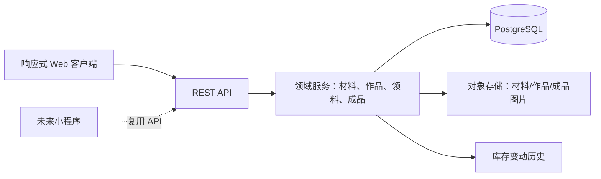

# 皮具管理系统：产品需求与设计规格

## Summary

Leather Manager 是一个部署在服务器上的个人皮具管理系统。它以响应式网页为首个客户端，帮助用户按类型与颜色管理皮革材料库存、记录想做和制作中的作品、通过领料自动同步库存，并在作品完成后建立可追溯的成品档案；服务端 API 为未来小程序保留复用能力。

## Todo

- 建立材料库存、作品、领料记录和成品档案的产品边界与数据关系。
- 定义支持桌面与手机浏览器的首版信息架构与交互状态。
- 确立前后端分离、API 优先的部署架构和数据一致性规则。
- 制定可独立交付的首版实施路线与后续扩展边界。

## Background

- 个人皮具创作同时涉及原材料库存、创作灵感和已完成成品，分散记录会使材料余量与作品来源难以追溯。
- 用户需要按类型和颜色检索材料与成品，并能维护材料库存。
- 用户需要从作品中记录实际领用的材料，让库存随制作过程更新。
- 首版需可部署到服务器，并在桌面及手机浏览器中使用；小程序不是首版交付物。

### Assumptions

- 系统首版仅供一个人使用，不提供注册、多用户协作、角色或权限管理。
- 每种材料以一个库存条目管理；采购批次、供应商、单价和损耗成本留待后续版本。
- 图片由服务端管理引用，部署环境具备可用的 S3 兼容对象存储或等价持久化图片服务。
- 库存数量以材料条目指定的单位记录，例如张、平方尺、平方分米或件。

## Goals and Non-goals

- Ensure 用户能新增、调整、检索和安全删除材料库存，按类型和颜色快速筛选。
- Ensure 用户能建立作品并在“想做、制作中、已完成”之间管理进度。
- Ensure 用户能为作品登记领料，且库存变化可追溯、不会出现负库存。
- Ensure 用户能从完成作品建立成品档案并查看其材料溯源。
- Ensure 同一 API 能服务响应式网页和未来的小程序客户端。
- Avoid 在首版中引入采购单、供应商、销售订单、利润、工时或复杂报表。
- Avoid 在首版中实现多用户、权限、通知、条码扫描或离线同步。
- Avoid 将小程序作为首版交付范围。

## Functional requirements

### 材料库存

- 用户可以新增材料，至少填写名称、类型、颜色、计量单位和初始库存；可选填写描述、存放位置和多张图片。
- 用户可以查看材料列表，并按关键字、类型、颜色和库存状态筛选；库存状态包含正常、低库存和无库存。
- 用户可以增加或减少库存，并在每次变动中保留时间、变动量、原因和变动后的结余。
- 用户只能删除库存为零、且没有领料历史的材料；其他情况应显示不能删除的原因。

### 作品与领料

- 用户可以创建作品，填写名称、目标类型、主色、状态、设计说明和参考图片。
- 用户可以将作品状态在“想做、制作中、已完成”之间切换；完成前允许补充完成图片和完成日期。
- 用户可以为作品新增、修改或撤销领料记录；每条记录关联一项材料和实际用量。
- 新增或增加领料时，系统必须先验证可用库存；若不足，拒绝操作并指出缺少的材料和数量。
- 修改、撤销领料，或删除包含领料的作品时，系统必须按差额回补库存，并保留变动历史。

### 成品档案

- 用户可以从已完成作品创建成品档案；档案默认继承作品名称、类型、主色、完成时间、完成图片和领料溯源。
- 用户可以独立维护成品档案并按名称、类型和颜色筛选。
- 成品详情应显示来源作品和材料清单；材料清单应能定位到仍存在的材料详情。

### UI design

- 桌面端以侧边导航组织“仪表盘、材料库存、作品库、成品档案、设置”；手机端以底部导航呈现相同核心入口。
- 仪表盘应显示材料种类数、低库存数量、制作中作品，并提供“新增材料”和“新建作品”的快捷入口。
- 材料库存默认以可筛选的列表或卡片展示；作品库应同时支持状态看板和列表；成品档案以图文卡片或列表浏览。
- 表单保存、库存不足、删除限制、空列表与图片上传失败均必须提供明确的中文反馈，且不会丢失已填写的有效内容。
- 主要操作在窄屏下无需横向滚动；所有图标操作均需有可读标签或辅助文字。

### System design

系统采用 API 优先的前后端分离边界：Web 客户端只通过 REST API 访问领域数据；领域服务拥有库存、领料和作品状态规则；关系型数据库持久化业务记录；对象存储保存图片，数据库保存其元数据与关联。库存变更与领料变更必须作为同一原子业务操作提交，避免并发访问产生不一致的结余。

领域对象与责任：

- **材料**拥有基础属性、计量单位、库存阈值和当前结余；库存变动历史是其可审计事实来源。
- **作品**拥有创作状态、说明、图片和其领料集合；它不直接修改材料结余。
- **领料记录**拥有材料、作品和数量；它是触发库存扣减与回补的唯一业务入口。
- **成品档案**拥有可独立展示的成品元数据，并保留到来源作品和领料清单的链接。

#### Alternatives considered

- **将库存数量直接编辑在材料表中**：被拒绝。它无法说明某次库存变化来自何处，也无法在撤销领料时可靠回补。
- **首版直接采用单体全栈网页框架**：被拒绝。它的初始配置更少，但会弱化为小程序等后续客户端复用 API 的边界。
- **Vue + Spring Boot 或 React + FastAPI**：均可实现目标，但 React + NestJS 让首版前后端共享 TypeScript 类型与工程习惯，更适合个人长期维护。

## Non-functional requirements

- 在不超过 2,000 个材料、2,000 个作品和 20,000 条库存变动记录的个人数据规模下，常用列表筛选的服务端响应时间目标为 P95 小于 500 ms（不含图片下载）。
- 材料、领料和库存变动的写入必须具备事务一致性：失败时不应留下部分扣减或部分回补。
- 图片上传必须限制允许的图片格式与单文件大小，并在失败时保留业务记录的已有图片关联。
- 数据库与对象存储应至少每日备份一次；恢复流程应可验证材料、作品、领料和成品关联完整。
- API 应为未来客户端保留版本化路径和一致的错误响应结构。

## Acceptance criteria

- 用户可新增一项“棕色植鞣革”材料并按“植鞣革”和“棕色”筛选到它，列表展示其当前库存与单位。
- 用户为制作中的作品登记 0.35 平方尺材料时，该材料当前库存和库存历史同步出现相反方向、数量一致的变化。
- 当登记用量超过可用库存时，领料不会保存，材料库存与既有领料记录保持不变，并显示库存不足反馈。
- 用户撤销一条已保存领料后，材料库存按原领料量回补；历史能区分领料与回补。
- 用户可将已完成作品生成成品档案，并在成品详情中看到来源作品、完成图片、类型、颜色和材料清单。
- 有库存或领料历史的材料无法被删除，系统说明限制原因；无库存且无领料历史的材料可以被删除。
- 首版没有任何多用户注册、权限配置、采购、销售或小程序交付入口。

## Verification strategy

1. 使用一项材料、一件作品和一份成品档案走通“录入材料 → 创建作品 → 领料 → 完成 → 建档”的浏览器验收流程，核对每个状态及材料溯源。
2. 对材料筛选、库存调整、领料、库存不足、领料修改/撤销、作品删除回补和成品继承关系增加领域单元测试与 API 集成测试。
3. 使用并发请求验证同一材料的领料不会使库存变为负数，且失败请求不产生库存历史。
4. 以桌面宽度和常见手机宽度完成端到端关键流程检查，验证导航、筛选、表单和错误提示可用。
5. 每次发布前运行格式化、静态检查、单元测试、API 集成测试和生产构建；首版尚无小程序，因此不执行小程序构建验证。
6. 在预发布环境执行数据库与图片备份恢复演练，核验恢复后的作品、领料和成品链接仍完整。

## Open questions

- 低库存阈值在首版是每种材料单独配置，还是先采用全局默认值；建议首版支持材料级阈值，未设置时不提示低库存。
- 材料面积单位是否需要在首版统一换算；建议首版按条目原始单位计量，避免不可靠的单位换算。
- 成品是否允许不来源于作品而直接新建；建议允许，以便补录历史作品，但应明确标为“手动建档”。
- 服务器、域名、对象存储供应商和备份保留周期尚待部署阶段确定。
# Inventory deletion clarification

A material at zero may be deleted when its sole movement is its zero-valued opening balance; that bookkeeping row is deleted atomically with the material. Any nonzero opening balance or any later adjustment/allocation movement remains traceable and blocks deletion.
